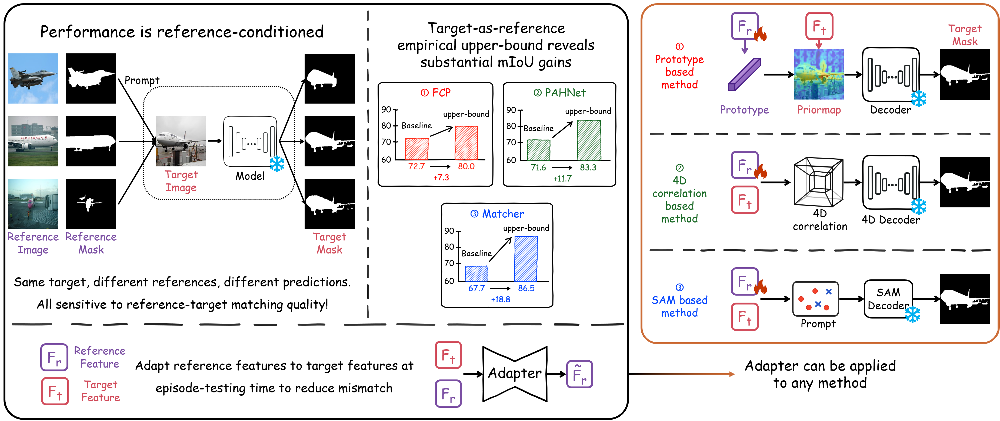
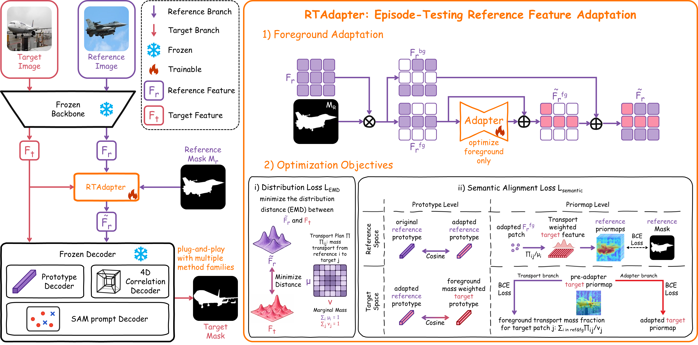

<div align="center">
# RTAdapter: Exploring the Upper Bound of In-Context Segmentation from a Data-Centric Perspective
</div>

## Motivation

Predictions in in-context segmentation can vary substantially with the reference. Our target-as-reference diagnostic reveals considerable performance headroom while keeping the prediction model frozen.



## Method

RTAdapter adapts reference foreground features to the current target through semantically regularized optimal transport, without updating the original prediction model or requiring target annotations.


## Main Results

Results on PASCAL-5i and COCO-20i in **mIoU (%)**. Each entry shows **baseline → + RTAdapter**. `*` denotes our reproduction.

| Method | PASCAL-5i 1-shot | PASCAL-5i 5-shot | COCO-20i 1-shot | COCO-20i 5-shot |
| --- | ---: | ---: | ---: | ---: |
| FCP* | 72.7 → **73.7** | 72.6 → **73.3** | 52.5 → **55.0** | 55.6 → **56.8** |
| PAHNet | 71.6 → **72.9** | 75.3 → **76.5** | 50.2 → **51.4** | 57.5 → **58.6** |
| Matcher* | 67.7 → **71.5** | 75.2 → **77.2** | 52.4 → **54.0** | 60.7 → **61.9** |
| FSSAM | 81.0 → **82.3** | 85.4 → **86.5** | 62.3 → **63.3** | 69.3 → **71.1** |

See the paper for results on object-part segmentation, cross-domain segmentation, and personalized multimodal understanding.

## Getting Started

Follow your baseline repository to prepare its environment, datasets, and model weights. The configuration loader additionally requires PyYAML:

```bash
pip install pyyaml
```

### 1. Load the adapter configuration

After parsing the command-line arguments, load the benchmark-specific YAML file:

```python
import os
import yaml

config_path = f"adapter_config/{args.benchmark}.yaml"
if not os.path.exists(config_path):
    raise FileNotFoundError(
        f"Configuration file not found: {config_path}. "
        "Please check the path and benchmark argument."
    )
with open(config_path, 'r', encoding='utf-8') as f:
    adapter_config = yaml.safe_load(f)
for key, value in adapter_config.items():
    setattr(args, key, value)
```

Run from the repository root. YAML values override existing arguments with the same names; use the keys expected by your `SQAdapter` implementation.

### 2. Insert RTAdapter into the baseline

The implementation uses the class name `SQAdapter`. After extracting reference and target features, add:

```python
sqadapter = SQAdapter(self.ref_masks_pool, self.nshot, self.device, self.args)
ref_feats_prime = sqadapter.transform(ref_feats, tar_feat)
```

Use `ref_feats_prime` instead of `ref_feats` in the original prototype construction, correlation computation, or prompt generation. Keep gradients enabled during adaptation while freezing the original model.

## Visualization


Results on PASCAL-5i (top) and COCO-20i (bottom). Columns compare reference annotations, target ground truth, baseline and adapted predictions, and priormaps. Target GT priormaps are used only for diagnostic visualization.
``

## Citation

If you find this work useful, please consider citing the manuscript:

```bibtex
@misc{fu_rtadapter,
  title  = {{RTAdapter}: Exploring the Upper Bound of In-Context Segmentation from a Data-Centric Perspective},
  author = {Fu, Ourui and Zhu, Lei and Chen, Qian and He, Hangzhou and Zeng, Shuang and Li, Kaiwen and Liang, Zhangxin and Yao, Zhengjian and Ming, Jinyi and Hu, Jiakui and Hu, Suhang and Lu, Yanye},
  note   = {Manuscript},
  url    = {https://github.com/forypipi/RTAdapter}
}
```

## Acknowledgements

We thank the authors of [FCP](https://github.com/SuhoPark0706/FCP) and [Matcher](https://github.com/aim-uofa/Matcher) for sharing their code.
